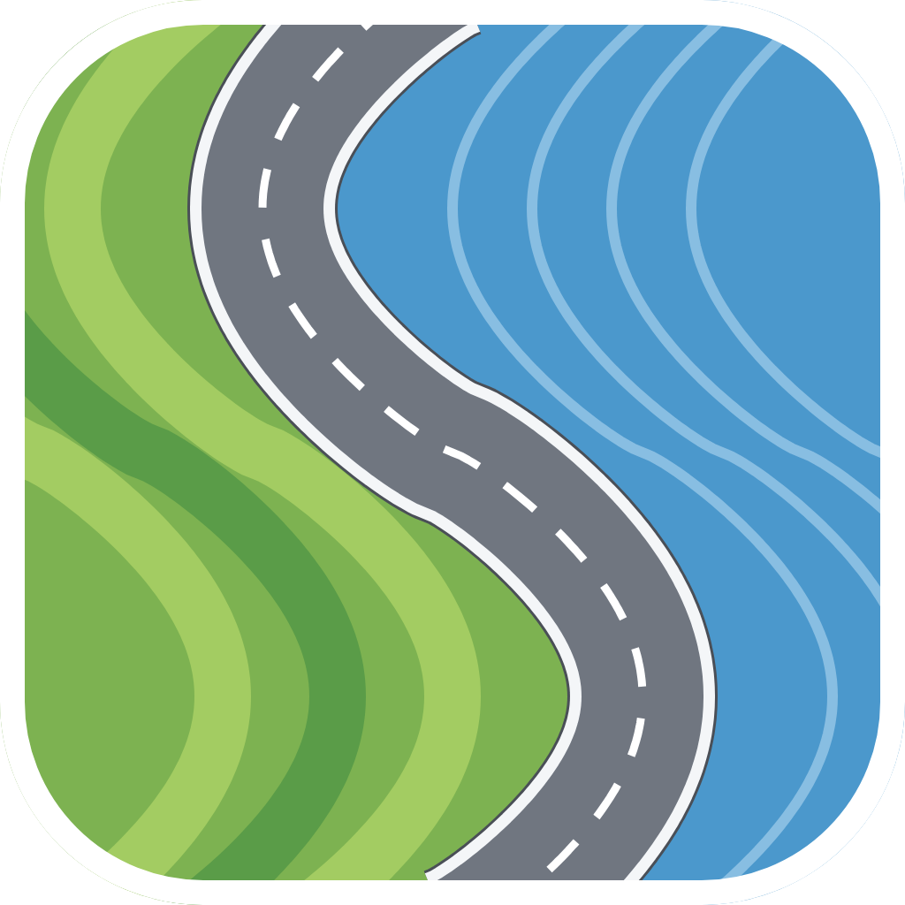

# Strasse

<p align="center">
  
</p>

<p align="center">
  <strong>Open, configurable navigation built with Flutter.</strong><br>
  A privacy-minded GPS navigation project for Android and iOS.
</p>

<p align="center">
  
  
  
</p>

Strasse is an independent navigation app project focused on configurable map and routing services, useful driving features, offline capabilities, and user control. It is built with **Flutter and Dart**, with an optional self-hostable backend.

The project aims to provide a flexible alternative to closed navigation ecosystems: users can choose compatible service providers, run their own infrastructure, and use the app without creating an account.

> [!IMPORTANT]
> **Strasse is under active development and is not yet presented as a production-ready navigation service.** The repository contains substantial application and backend code, but not every integration has been validated against live providers. Build and runtime behavior can vary by platform and configuration. See [Known limitations and verification status](#known-limitations-and-verification-status) before using it for real journeys.

## Contents

- [Project goals](#project-goals)
- [Features](#features)
- [Technology stack](#technology-stack)
- [How Strasse gets its data](#how-strasse-gets-its-data)
- [Getting started](#getting-started)
- [Service configuration](#service-configuration)
- [Building the app](#building-the-app)
- [Optional backend](#optional-backend)
- [Project structure](#project-structure)
- [Privacy](#privacy)
- [Known limitations and verification status](#known-limitations-and-verification-status)
- [Contributing](#contributing)
- [License](#license)
- [Documentation](#documentation)

## Project goals

Strasse is being developed around a few principles:

- **No advertising in the app.**
- **No mandatory account** for basic navigation features.
- **Configurable infrastructure:** map tiles, routing, geocoding, transit, and backend services can be selected or self-hosted.
- **Privacy by design:** no app telemetry is intentionally configured; optional features should remain optional.
- **Cross-platform development:** one Flutter codebase targets Android and iOS.
- **Transparency:** missing providers and unavailable data should be reported rather than replaced with invented information.

Strasse uses OpenStreetMap data where configured. OpenStreetMap data is © OpenStreetMap contributors and is available under the Open Database License (ODbL). See the [OpenStreetMap copyright page](https://www.openstreetmap.org/copyright).

## Features

The repository contains implementations for the following areas. Availability depends on the configured services, platform permissions, and the current development state.

### Maps and location

- Vector-map rendering with **MapLibre**.
- OpenStreetMap-compatible map data and OpenMapTiles-style vector sources.
- Current-location display, map orientation, and follow-position behavior.
- Configurable map appearance, including light, dark, automatic, and custom styles.
- Map detail controls and optional points-of-interest layers.
- Customizable vehicle marker and route colors.

### Routes and navigation

- Route modes for **car, walking, and cycling**, using a compatible Valhalla service.
- Public-transport route integration through **OpenTripPlanner (OTP)** when an OTP server with suitable GTFS data is configured.
- Route preferences such as avoiding toll roads and highways.
- Route previews, intermediate stops, and route comparison interfaces.
- Turn-by-turn navigation UI and French voice guidance.
- Automatic rerouting and handling for GPS interruptions.
- Optional keep-screen-on behavior and navigation notifications.

### Offline capabilities

- Downloadable map regions, subject to the capabilities of the configured map provider and Flutter map plugin.
- A local road-graph routing implementation based on OpenStreetMap data downloaded through Overpass.
- Local route calculation when a suitable graph has been downloaded.

Offline routing is deliberately more limited than online routing. See [Known limitations](#known-limitations-and-verification-status).

### Search and places

- Address and place search through a Nominatim-compatible geocoder.
- Recent searches and nearby categories.
- Place details, saved places, favorites, and collections.
- Home and work shortcuts.

### Trips and personal settings

- Trip history and a trip planner.
- Optional trip statistics.
- Configurable home-screen sections.
- Vehicle profiles and vehicle dimensions for supported routing requests.
- Customizable units, map style, colors, interface scale, and app icon.
- Multiple interface languages.

The language resources currently include French, English, German, Russian, Arabic, Chinese, Spanish, Italian, Portuguese, Polish, Dutch, and Japanese. Translation completeness and provider voice support may vary.

### Traffic and community reports

- Map incident display when a traffic provider is configured through the backend.
- Community incident reports with confirmation and rejection actions.
- Traffic data is not fabricated: if no traffic provider is available, the backend reports that traffic data is unavailable.

### Optional account and synchronization

- Optional account support through the configured account backend.
- Synchronization for supported favorites, collections, trips, and preferences.
- Account deletion endpoint in the Strasse backend.
- An account is not required for the basic local app experience.

### Assistant and media

- A local rule-based assistant module.
- Audio playback integration and platform media controls.
- Optional notifications for supported app events.

## Technology stack

| Area | Technology |
|---|---|
| Mobile application | Flutter, Dart |
| State management | Riverpod |
| Map rendering | MapLibre |
| Location | Geolocator |
| Local persistence | SQLite, shared preferences, secure storage |
| Online routing | Valhalla |
| Public transport | OpenTripPlanner |
| Geocoding | Nominatim-compatible API |
| Road data for offline routing | OpenStreetMap, Overpass |
| Optional backend | Node.js 22+, TypeScript, Fastify 5 |
| Backend database | PostgreSQL with PostGIS |
| Optional cache / rate-limit storage | Redis |
| Mobile build automation | Codemagic configuration included |

Flutter's official documentation explains its Android release process and the distinction between APK and Android App Bundle outputs: [Build and release an Android app](https://docs.flutter.dev/deployment/android).

## How Strasse gets its data

Strasse is a **client application, not a bundled global navigation data service**. It does not include a worldwide map database or operate public routing servers by itself.

You must configure compatible services for the features you want to use:

| Capability | Service | Required for |
|---|---|---|
| Map tiles | OpenMapTiles-compatible TileJSON or tile URL | Displaying the map |
| Map fonts | Map glyph endpoint | Rendering map labels |
| Online road routing | Valhalla | Online car, walking, and cycling routes |
| Address search | Nominatim-compatible geocoder | Geocoding and place search |
| Public transport | OpenTripPlanner with suitable GTFS feeds | Transit routes |
| Offline road data downloads | Overpass API | Downloading a local routing graph |
| Accounts, sync, reports, traffic | Strasse backend or supported account provider | Optional online features |

You may use a provider that permits your intended use, or host compatible services yourself. **A service being publicly reachable does not mean it is free for unlimited app use.** Always review its usage policy, rate limits, attribution requirements, and commercial terms.

In particular, do not use the public Nominatim endpoint for intensive production app traffic. Its usage policy restricts how it may be used by applications. Prefer a suitable hosted provider or your own instance.

## Getting started

### Requirements

The current `pubspec.yaml` declares:

- **Flutter:** 3.32.0 or newer.
- **Dart:** 3.8.0 or newer.
- **Android:** Android SDK tooling and Java 17 or newer. The current Android app configuration uses `minSdk = 24`.
- **iOS:** macOS, Xcode, and CocoaPods. The iOS Podfile targets iOS 13.0 or newer.
- **Optional backend:** Node.js 22 or newer; PostgreSQL with PostGIS and Redis when running the full Docker setup.

Use a Flutter SDK version compatible with the packages and Android Gradle configuration in this repository.

### 1. Get the source code

```bash
git clone https://github.com/lastapps888/Strasse_beta.git
cd Strasse_beta
```

### 2. Install Flutter dependencies

```bash
flutter pub get
```

### 3. Create a local service configuration

```bash
cp config/env.example.json config/env.json
```

Edit `config/env.json` and replace the example hostnames with HTTPS endpoints for the services you intend to use. The example values are placeholders and are not working public services.

You can also configure or override service providers inside the app under **Settings → Services**. User-selected providers take precedence over compile-time values.

### 4. Run the app

```bash
flutter run --dart-define-from-file=config/env.json
```

If a required service is not configured or cannot be reached, the corresponding feature may be unavailable. A map requires a valid tile source and glyph source; online route calculation and search require their respective services.

### Generating native platform projects

The repository includes Android and iOS platform folders. If you need to generate or repair platform scaffolding in a fresh checkout, review [INSTALLATION.md](INSTALLATION.md) and the `tool/setup_platforms.sh` script before running it. The script invokes Flutter's project-generation tooling and applies Strasse-specific native settings; inspect the resulting Git diff before committing any generated changes.

## Service configuration

Configuration is supplied through `--dart-define-from-file` or through **Settings → Services** in the app. The in-app selection takes precedence over compile-time configuration.

The example file is [config/env.example.json](config/env.example.json).

| Variable | Purpose | Required |
|---|---|---|
| `STRASSE_ENV` | Environment label such as `dev`, `test`, or `prod` | No |
| `STRASSE_TILES_URL` | Vector TileJSON URL or tile URL template | For maps |
| `STRASSE_TILES_ATTRIBUTION` | Attribution text displayed for the map source | Recommended |
| `STRASSE_GLYPHS_URL` | Map font endpoint, usually containing `{fontstack}/{range}.pbf` | For map labels |
| `STRASSE_MAP_FONT` | Font stack available from the glyph provider | Provider-dependent |
| `STRASSE_VALHALLA_URL` | Valhalla server base URL | For online road routes |
| `STRASSE_GEOCODER_URL` | Nominatim-compatible geocoder URL | For search |
| `STRASSE_OTP_URL` | OpenTripPlanner server URL | For public transport |
| `STRASSE_OVERPASS_URL` | Overpass API endpoint, usually ending in `/api/interpreter` | For offline road-data downloads |
| `STRASSE_API_URL` | Optional Strasse backend URL | For Strasse API features |

Example configuration structure:

```json
{
  "STRASSE_ENV": "dev",
  "STRASSE_API_URL": "https://api.example.org",
  "STRASSE_TILES_URL": "https://tiles.example.org/data/v3.json",
  "STRASSE_TILES_ATTRIBUTION": "© Map data provider",
  "STRASSE_GLYPHS_URL": "https://tiles.example.org/fonts/{fontstack}/{range}.pbf",
  "STRASSE_MAP_FONT": "Noto Sans Regular",
  "STRASSE_VALHALLA_URL": "https://valhalla.example.org",
  "STRASSE_GEOCODER_URL": "https://nominatim.example.org",
  "STRASSE_OTP_URL": "",
  "STRASSE_OVERPASS_URL": ""
}
```

### Security rules for service configuration

- Use **HTTPS** endpoints. The app's Android manifest disables cleartext traffic.
- Do not put private API keys, database passwords, signing passwords, or backend secrets in the mobile app.
- A mobile application can be inspected; values embedded at build time must be treated as public.
- Keep private backend configuration in server-side environment variables.
- Respect provider attribution and usage policies.
- Do not commit your personal `config/env.json` or secret files.

For more details, see [CONFIGURATION.md](CONFIGURATION.md).

## Building the app

### Android APK

```bash
flutter build apk --release --dart-define-from-file=config/env.json
```

The APK is generated at:

```text
build/app/outputs/flutter-apk/app-release.apk
```

### Android App Bundle

For Google Play distribution, an Android App Bundle is generally preferred:

```bash
flutter build appbundle --release --dart-define-from-file=config/env.json
```

Output:

```text
build/app/outputs/bundle/release/app-release.aab
```

For a production release, configure your own Android upload keystore using [android/key.properties.example](android/key.properties.example). Keep the keystore and passwords backed up securely; never commit them.

### iOS

An iOS build requires macOS and Xcode:

```bash
cd ios
pod install
cd ..
flutter build ipa --release --dart-define-from-file=config/env.json
```

Configure signing in Xcode under **Runner → Signing & Capabilities**. A free Apple account can be used for limited device testing; App Store distribution and TestFlight require the appropriate Apple Developer Program access.

The Codemagic workflow in [codemagic.yaml](codemagic.yaml) currently builds Android and iOS artifacts. Its iOS packaging step creates an **unsigned IPA** from the built app. An unsigned IPA is not equivalent to an App Store-ready, signed distribution build.

See [GUIDE_APK_IPA.md](GUIDE_APK_IPA.md) for the repository's build notes.

## Optional backend

The backend is separate from the Flutter app. It is intended for optional account features, synchronization, community reports, and externally supplied traffic incidents.

### Stack

- Node.js 22+
- TypeScript
- Fastify 5
- PostgreSQL 14+ with PostGIS for production storage
- Redis 6+ (optional, used by the backend setup)

### Run locally

```bash
cd backend
npm install
npm run dev
```

Without a configured `DATABASE_URL`, the backend can use in-memory storage for development. This is not suitable for production and data will not be durable.

For the Docker deployment, configure the required environment variables (including a strong PostgreSQL password and backend secrets) and then run:

```bash
cd backend
docker compose up --build
```

The API listens on port `8080` by default in the Docker configuration.

Useful backend commands:

```bash
npm run typecheck
npm test
npm run build
npm run migrate
```

### API overview

The API uses the `/v1` prefix. Main endpoints include:

| Endpoint | Purpose |
|---|---|
| `GET /v1/health` | Health check |
| `POST /v1/auth/register`, `POST /v1/auth/login` | Account registration and login |
| `POST /v1/auth/refresh`, `POST /v1/auth/logout` | Token lifecycle |
| `DELETE /v1/account` | Account deletion |
| `GET /v1/sync/pull`, `POST /v1/sync/push` | Synchronization |
| `GET /v1/reports`, `POST /v1/reports` | Community reports |
| `POST /v1/reports/:id/confirm`, `POST /v1/reports/:id/reject` | Report feedback |
| `GET /v1/traffic/incidents` | Traffic incidents, when a provider is configured |

See [API.md](API.md) for the API contract and [backend/README.md](backend/README.md) for backend deployment and security details.

## Project structure

```text
.
├── android/              Android host project
├── ios/                  iOS host project
├── assets/               App assets, icons, logos, translations
├── backend/              Optional Fastify API and database migrations
├── config/               Example build-time service configuration
├── docs/                 Privacy, limitations, progress, and design notes
├── lib/
│   ├── app/              App shell, navigation, shared UI, and theme
│   ├── core/             Configuration, storage, errors, and utilities
│   ├── data/             API clients, repositories, and providers
│   ├── domain/           Domain models and entities
│   └── features/         Map, routing, navigation, search, trips, settings,
│                        favorites, offline features, traffic, sync, and more
├── platform_assets/      Platform-specific assets
├── supabase/             Supabase schema and related backend resources
├── test/                 Flutter unit and widget tests
├── tool/                 Platform setup and maintenance scripts
├── pubspec.yaml          Flutter dependencies and app metadata
└── codemagic.yaml        Codemagic build workflow
```

The Flutter app is organized by feature, with shared application, core, domain, and data layers. See [ARCHITECTURE.md](ARCHITECTURE.md) for more detail.

## Privacy

Strasse is designed to minimize unnecessary data collection:

- No advertising SDK or app analytics/telemetry is intentionally configured in the application.
- Location access is used for map positioning and navigation when the user grants permission.
- Map, routing, geocoding, transit, and other external requests go to the providers selected or configured by the user. Those providers may process request data under their own privacy policies.
- Local preferences and app data are stored on the device.
- History and statistics can be disabled in the app settings.
- Account creation and synchronization are optional.
- The app does not need an account to display a configured map or use local features.

The optional backend is designed not to store GPS route history. Its report system uses a pseudonymous installation identifier to limit duplicate voting. Synchronized data can be encrypted at rest when the server is configured with `SYNC_ENCRYPTION_KEY`.

These statements describe the repository's intended implementation and configuration. They are not a substitute for an independent security audit or a review of the privacy policies of external providers.

See [docs/CONFIDENTIALITE.md](docs/CONFIDENTIALITE.md).

## Known limitations and verification status

Strasse is still being developed. Please read this section before relying on it for navigation.

### Service-dependent features

- A working vector tile source and glyph endpoint are required for a fully rendered map.
- Online car, walking, and cycling routes require a compatible Valhalla server.
- Public-transport routing requires a compatible OpenTripPlanner server with appropriate GTFS data.
- Search requires a compatible geocoding service.
- Traffic display requires a supported provider configured on the backend. Without one, traffic is unavailable.
- Place photos and speed-limit data are not currently backed by a configured data source.

### Offline routing constraints

The current local routing implementation has known limitations:

- The road graph must be downloaded before offline routing can work.
- The downloaded graph covers a limited area (approximately 35 km across, depending on the downloaded region).
- The start, intermediate stops, and destination must all be inside the same downloaded graph.
- Turn restrictions and elevation-aware routing are not implemented.
- Traffic and public-transport routing are unavailable offline.
- Only one route is produced; online route alternatives are not reproduced.
- Speeds are estimated from OpenStreetMap speed-limit data when available, otherwise from fallback values.
- Offline instructions are simpler than Valhalla's online instructions.

### Build and integration verification

The repository includes Flutter tests and backend tests, but the presence of tests does not mean every test or live integration has passed. Android and iOS builds, provider compatibility, background behavior, and production backend deployment must be verified in the target environment before release.

The project has encountered Android Gradle and plugin compatibility issues during development. Treat the current branch as a development snapshot until a clean Android build, a clean iOS build, and relevant runtime tests have been completed.

See [docs/LIMITES.md](docs/LIMITES.md) and [docs/PROGRESS.md](docs/PROGRESS.md) for the detailed verification notes and development status.

## Contributing

Contributions, bug reports, and focused improvements are welcome.

Before opening a pull request:

1. Keep changes scoped to the issue being addressed.
2. Avoid changing unrelated screens, behavior, or platform configuration.
3. Run formatting and static analysis:
   ```bash
   dart format .
   flutter analyze
   ```
4. Run Flutter tests:
   ```bash
   flutter test
   ```
5. If you change the backend, run its checks from the `backend/` directory:
   ```bash
   npm run typecheck
   npm test
   npm run build
   ```
6. Document new service requirements, configuration variables, permissions, and known limitations.
7. Never include credentials, signing keys, personal service URLs, or private user data in commits.

For substantial changes, describe the motivation, the files affected, how the change was tested, and any remaining risks.

## License

No license file is currently included in this repository. Until a license is added, the source code is **not granted an open-source license**. Do not assume that you may redistribute, modify, or reuse it simply because it is hosted on GitHub.

## Documentation

- [Installation](INSTALLATION.md)
- [Service configuration](CONFIGURATION.md)
- [Android APK and iOS IPA build guide](GUIDE_APK_IPA.md)
- [Architecture](ARCHITECTURE.md)
- [Backend API](API.md)
- [Backend setup](backend/README.md)
- [Privacy notes](docs/CONFIDENTIALITE.md)
- [Known limitations](docs/LIMITES.md)
- [Development progress](docs/PROGRESS.md)

---

<p align="center">
  <sub>Built with Flutter · Maintained by lastapps888</sub>
</p>
