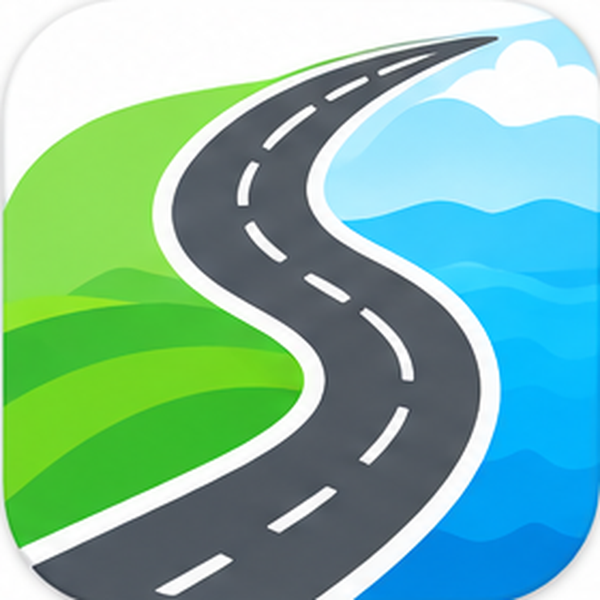
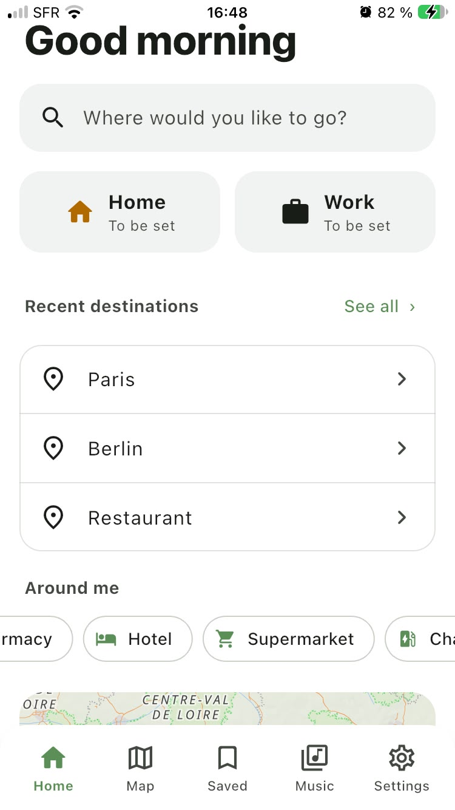
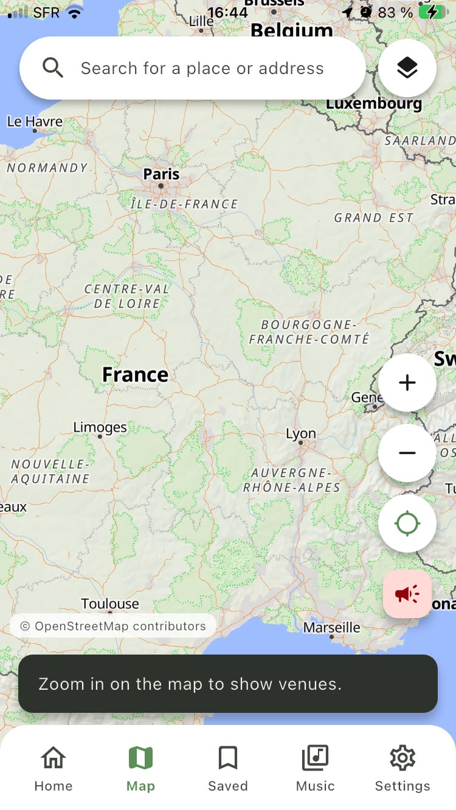
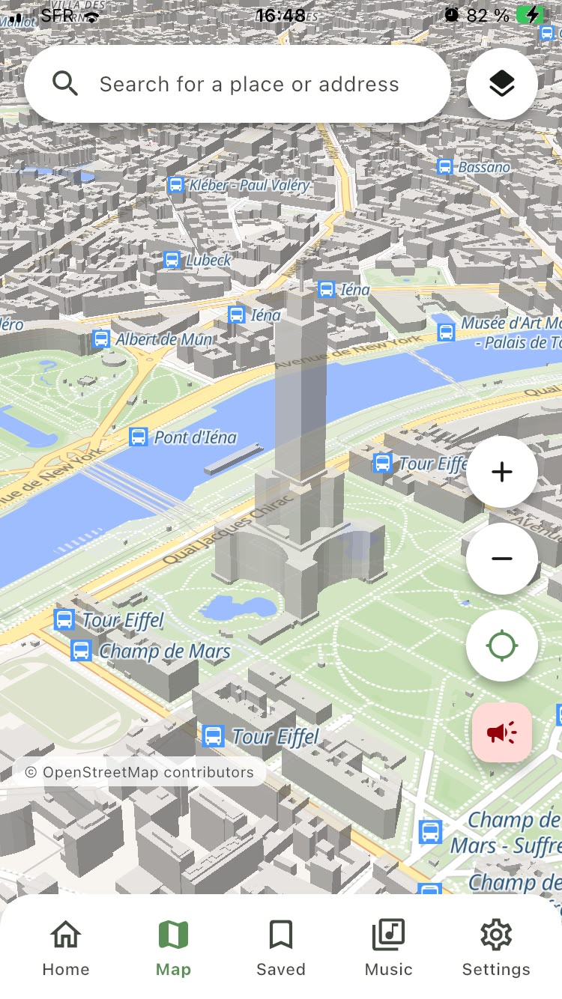
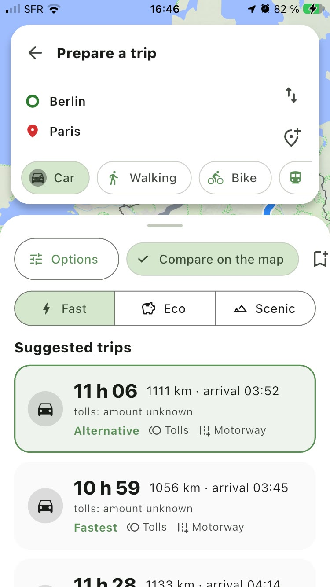
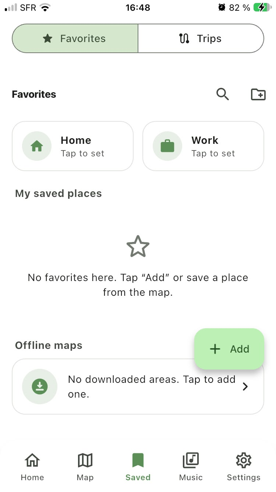
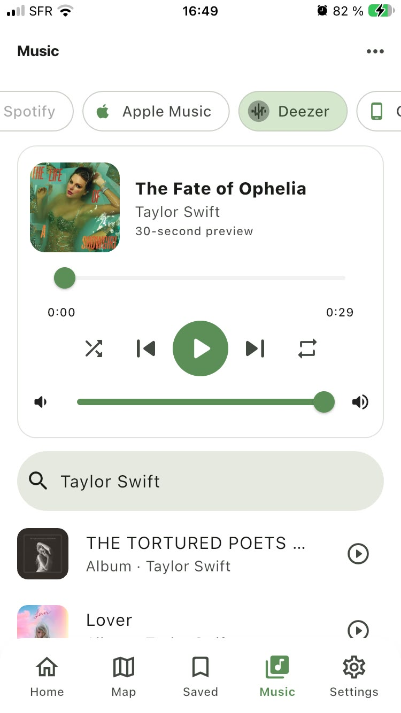
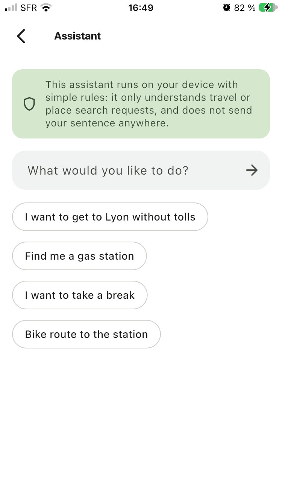
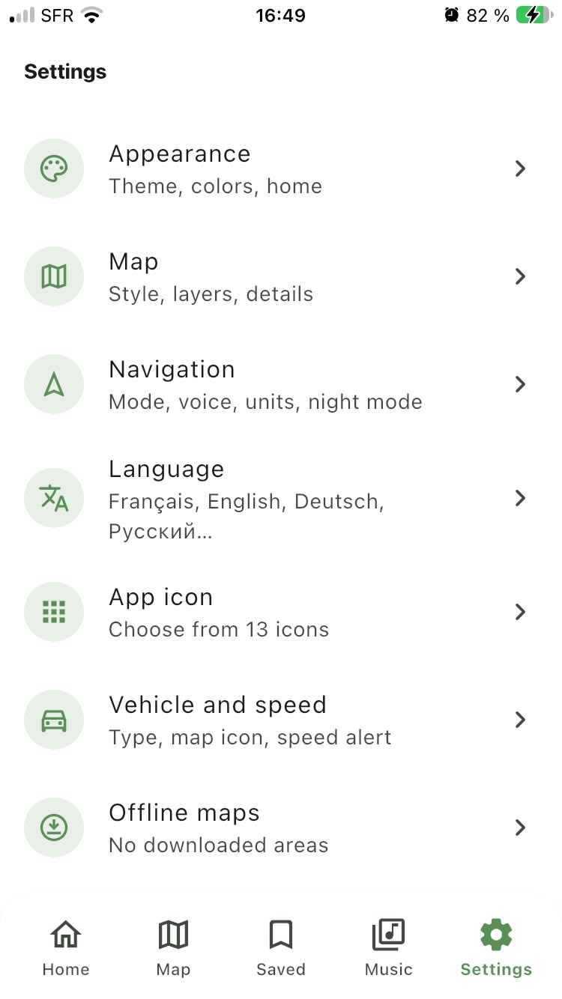

# Strasse

<p align="center">
  
</p>

<p align="center">
  A GPS navigation app for Android and iOS, built with Flutter.
</p>

<p align="center">
  <a href="https://github.com/lastapps888/Strasse/releases/">
    
  </a>
  <a href="https://github.com/lastapps888/Strasse/releases/">
    
  </a>
</p>

<p align="center">
  <a href="https://github.com/lastapps888/Strasse/issues">Report a bug</a>
  ·
  <a href="https://github.com/lastapps888/Strasse/issues">Request a feature</a>
</p>

---

## About Strasse

Strasse is a navigation app I'm developing as an independent project. The idea is simple: build a useful GPS app with a clean interface, plenty of customization options and as few unnecessary restrictions as possible.

It is designed for everyday journeys, whether you're driving, walking or cycling. Maps, routing and other services can be configured independently, so Strasse isn't tied to a single provider.

The app is built with Flutter and Dart and is available for both Android and iOS.

## Screenshots

Here are a few views of Strasse.

<p align="center">
  
  
  
  
    
    
    
    
</p>

## Features

### Maps and navigation

- Interactive maps powered by MapLibre.
- Current location and map orientation.
- Car, walking and cycling routes.
- Turn-by-turn navigation with voice guidance.
- Route previews and intermediate stops.
- Automatic rerouting.
- Custom map styles and navigation appearance.

### Search and places

- Address and place search.
- Nearby places and categories.
- Saved places and favorites.
- Custom collections.
- Home and work shortcuts.
- Recent searches.

### Offline maps and routing

Strasse includes offline map and routing features for areas you've downloaded in advance.

Offline routing uses locally stored OpenStreetMap road data. It is useful when an internet connection isn't available, although it has fewer options than online routing.

### More than just navigation

Other parts of the app include:

- Trip history and statistics.
- A trip planner.
- Vehicle profiles and route preferences.
- Community road reports.
- Optional account and synchronization features.
- A built-in assistant.
- Audio playback integration.
- Notifications and navigation settings.

### Customization

Strasse offers several ways to adjust the app to your preferences:

- Light and dark themes.
- Map appearance and colors.
- Interface settings.
- Distance and measurement units.
- Home screen customization.
- Multiple interface languages.

## Maps and service providers

Strasse uses open-source mapping technology and lets you choose compatible service providers.

| Service | Technology |
|---|---|
| Map rendering | MapLibre |
| Map data | OpenStreetMap |
| Online routing | Valhalla |
| Public transport | OpenTripPlanner |
| Address search | Nominatim |
| Offline road data | Overpass API |

You can configure service URLs in the app under **Settings → Services** or through the configuration file.

Some services need to be hosted separately. Public endpoints may have usage limits, so check their terms before using them in a production environment.

OpenStreetMap data is © OpenStreetMap contributors. See the [OpenStreetMap copyright page](https://www.openstreetmap.org/copyright).

## Privacy

Privacy is one of the reasons behind Strasse.

The app is designed to work without requiring an account for its basic navigation features. Location is used for the features that need it, and external map or routing requests are sent to the providers configured by the user.

The optional backend provides account, synchronization and community-report features.

There are no advertising features planned as part of the app.

For more information, see [Privacy documentation](docs/CONFIDENTIALITE.md).

## Tested devices and bug reports

Strasse has been tested on several Android and iOS devices.

Different devices and operating system versions can still behave differently, and bugs may occur. If you find something that doesn't work as expected, please report it in [GitHub Issues](https://github.com/lastapps888/Strasse_beta/issues).

When reporting a bug, please include:

- Your device model.
- Your Android or iOS version.
- What you were trying to do.
- What happened instead.
- A screenshot or screen recording, if relevant.

Feature suggestions are welcome too.

## Technology

Strasse is built with:

- **Flutter and Dart** for the mobile application.
- **Riverpod** for state management.
- **MapLibre** for map rendering.
- **SQLite** and local storage for on-device data.
- **Valhalla** for online routing.
- **OpenTripPlanner** for public transport.
- **Node.js, TypeScript and Fastify** for the optional backend.
- **PostgreSQL and PostGIS** for backend data storage.

## Repository structure

```text
.
├── android/          Android platform files
├── ios/              iOS platform files
├── assets/           Logos, icons and translations
├── backend/          Optional Strasse API
├── config/           Example service configuration
├── docs/             Project documentation
├── lib/              Flutter application source
├── supabase/         Supabase resources
├── test/             Flutter tests
├── tool/             Development tools
├── API.md            Backend API documentation
├── ARCHITECTURE.md   Application architecture
└── pubspec.yaml      Flutter dependencies
```

## Documentation

A few useful files if you want to explore the project:

- [Installation](INSTALLATION.md)
- [Service configuration](CONFIGURATION.md)
- [Architecture](ARCHITECTURE.md)
- [Known limitations](docs/LIMITS.md)
- [Changelog](CHANGELOG.md)

## Contributing

Strasse is an independent project, and suggestions, bug reports and contributions are welcome.

If you want to contribute, open an issue first to discuss larger changes. Pull requests should focus on one change at a time and include a short explanation of what was changed.

Please avoid committing private API keys, passwords or signing certificates.

## License

Copyright (c) [2026] Lastapps888. All rights reserved.

Public access to this source code is granted solely for the purposes of consultation,
learning, and personal inspiration.

Terms of Use:
1. Non-commercial use only: Any commercial use—whether direct or indirect—of all or
part of this code is strictly prohibited without prior written authorization.
2. Partial reuse only: Copying the project in its entirety or in a substantial
manner is prohibited. Only the reuse of limited excerpts or the general
structure for a separate project is permitted.
3. Mandatory attribution: Any reuse, even partial, must clearly credit the
original author (Lastapps888) and include a link to this repository.
4. Mandatory notification: Before publishing or making available online any
project that incorporates a portion of this code, you must notify the
author at the following address: srohsed.barjo.projet@gmail.com.

Any use that does not comply with these terms constitutes a copyright infringement.
---

<p align="center">
  Made by <strong>lastapps888</strong>
</p>
